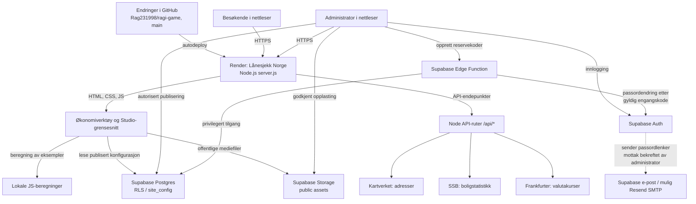
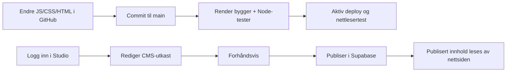

# Lånesjekk Norge – plattformer, arkitektur og sikkerhetsstatus

**Kontrollert:** 25. oktober 2026 · **Kilde:** GitHub-kode, Render-produksjonskonfigurasjon, Supabase-database/policies og sikkerhetsrådgiver.  
**Omfang:** Lånesjekk Norge. Supabase-prosjektet `drivpris-norge` deler infrastruktur med andre løsninger; en sikkerhetsendring der kan derfor få konsekvenser for andre applikasjoner.

> **Viktig:** Implementert kode er ikke det samme som testet leveranse. Ingen hemmelige API-nøkler, reservekoder, private e-postadresser eller passord hører hjemme i denne filen.

## 1. Kontrollpaneler og hvilke oppgaver de har

| Tjeneste | Rolle og hva du administrerer | Konkret adresse / identifikator | Kontrollstatus |
| --- | --- | --- | --- |
| **GitHub** | Kildekode, commit-historikk, dokumentasjon, testskript og GitHub Actions. Oppdatering av `main` kan starte deploy. | [Rag231998/ragi-game / lanesjekk-norge](https://github.com/Rag231998/ragi-game/tree/main/lanesjekk-norge) | Aktiv |
| **Render** | Faktisk produksjonsserver, Node.js-drift, byggebeskjeder, deploys, helsesjekk og logger. | [Render: lanesjekk-norge](https://dashboard.render.com/web/srv-dbecojo473hc73csuvlg) | Aktiv og sist bekreftet live |
| **Lånesjekk Studio** | Redigering av visse layouter, tekster, media og publisert CMS-konfigurasjon; bruk administratorkonto. | [Studio](https://lanesjekk-norge.onrender.com/studio-admin.html) | Implementert, avgrenset til CMS-feltene |
| **Supabase Auth** | Kontoer, passord, sesjoner, tillatte redirect-adresser og eventuell SMTP-konfigurasjon. | [Authentication](https://supabase.com/dashboard/project/pryrgwfjniggjlrizenh/auth/users) | Aktiv; bruker har bekreftet at passordlenke via e-post fungerer (25.10.2026) |
| **Supabase Database** | `admins`, site-konfigurasjon, revisjoner, rentesats-data, reservekode-hasher og RLS. | [Database](https://supabase.com/dashboard/project/pryrgwfjniggjlrizenh/editor) | Aktiv; sikkerhetsrådgiver har åpne funn |
| **Supabase Storage** | `site-assets` og `animation-assets`: logo, bilder, poster og video; filer i disse bucketene er offentlig lesbare. | [Storage](https://supabase.com/dashboard/project/pryrgwfjniggjlrizenh/storage/buckets) | Aktiv konfigurasjon; opplastingsrutiner krever videre QA |
| **Supabase Edge Functions** | Serverkjøring for engangs-reservekoder og privilegerte admin-operasjoner. | [Functions](https://supabase.com/dashboard/project/pryrgwfjniggjlrizenh/functions) | `lanesjekk-admin-recovery` distribuert |
| **Resend** | SMTP-/e-postleverandør brukt i oppsett av passordlenker; utsendingslogger og avsenderrettigheter administreres her. | [Resend](https://resend.com/) | **Passord-e-post bekreftet fungerende av administrator 25.10.2026**; leveransegrenser og SMTP-konfigurasjon er ikke uavhengig inspisert |
| **dynv6** | Gratis DNS-underdomene prøvd til e-postverifisering. Ikke domene for aktiv nettside. | [dynv6](https://dynv6.com/) | Forsøk, **ikke produksjonsavhengighet** |
| **Vercel** | Tidligere/alternativt publiseringsoppsett og gamle integrasjonsvarsler. | [Vercel](https://vercel.com/dashboard) | **Ikke** bekreftet produksjonsplattform for portalen |
| **Kartverket** | Adresser, postnumre, kommunenummer gjennom vårt API. | [Kartverket](https://www.kartverket.no/) | Ekstern datakilde; avhengig av tilgjengelighet |
| **SSB** | Kommunevis boligstatistikk, ikke e-takst for individuell adresse. | [SSB Statistikkbanken](https://www.ssb.no/statbank) | Ekstern datakilde |
| **Frankfurter** | Historiske/daglige valutareferansekurser, ikke bankenes sanntidstilbud. | [Frankfurter](https://frankfurter.dev/) | Ekstern datakilde |

**Tre steder å sjekke først når noe stopper:** GitHub (hvilken kode), Render (hvilken commit kjører faktisk), Supabase (innlogging og CMS/data). Resend er relevant spesifikt ved e-postfeil.

## 2. Systemdiagram: hva går hvor?

**Les diagrammet slik:** Render leverer nettstedet; Supabase er separat for admin/kontostyring og CMS. Renteberegninger og budsjettberegninger skjer i stor grad lokalt i nettleseren. Valuta og eiendomsstatistikk kan kalle serverruter, som igjen henter eksterne data. GitHub er ikke en database.

## 3. Forskjellen mellom å oppdatere kode og å publisere innhold

Det er to uavhengige løp. Et nytt menyvalg i HTML krever kode-deploy; endringer i tekst/logo/layout som Studio faktisk støtter, kan publiseres via CMS.

## 4. Passord, e-post og gjenoppretting

**Primærflyt:** Studio → «Glemt passord?» → Supabase Auth `resetPasswordForEmail` → e-postadresse registrert i Auth → lenke til `admin-password.html` → nytt passord.

**Reserveflyt:** Mens administrator er innlogget, opprettes tre 256-bit engangskoder. Bare SHA-256-hash lagres i `lanesjekk_admin_recovery_codes`, og en kode forbrukes før serverfunksjonen forsøker passordendring. Reservekoder er frivillige.

- 24. oktober viste eldre Auth-logger flere `429 over_email_send_rate_limit`.
- 24. oktober kl. 22:45 UTC aksepterte Supabase en ny `/recover`-forespørsel med HTTP 200. HTTP 200 beviser ikke alene levering, men administrator har i etterkant bekreftet at passord-e-post fungerer (25.10.2026).
- **Brukerbekreftet status 25.10.2026:** Passord-e-post fungerer. Denne bekreftelsen kommer fra administrator, ikke en uavhengig kontroll av SMTP-innstillingene eller en dokumentert ende-til-ende-test av passordbytte. Etter større endringer bør mottak, lenke og innlogging testes igjen.
- Resend kan ha begrensning på mottakere/avsender i testmodus uten domeneverifisering. Ingen nøkkel eller privat e-postadresse skal dokumenteres.

## 5. Sikkerhet: hva er kontrollert?

| Mekanisme | Bekreftet status / betydning |
| --- | --- |
| HTTPS | Publisert Render-URL er HTTPS; full TLS-konfigurasjon og header-revisjon ikke utført |
| Autentisering | Admin logger inn via Supabase Auth |
| Rolleautorisering | `admins`-tabell og RLS brukes; godkjent Supabase-bruker er ikke nødvendigvis administrator |
| RLS | Aktivert på de kontrollerte `public`-tabellene; forskjellige leser-/skriverettigheter |
| Medier | Offentlig lesing i de to Storage-bucketene, skrivetilganger med admin-kontroll i policies |
| Privilegerte nøkler | Ingen service-role-nøkkel funnet i undersøkt frontend; Edge Function får hemmelighet fra servermiljø |
| Reservekoder | Tilfeldig genererte, engangs, hashet; reell innlogging/gjenoppretting er ikke testet ende-til-ende |
| CI | Node-testene kontrollerer filer, ruting og grunnleggende invariants; nettleser- og penetrasjonstesting ikke fullført |
| Lånekalkulator | Inndata beregnes lokalt/valideres også i server-API ved bruk av dette; dette er ikke banktransaksjoner |

**Ikke konkluder med at nettsiden er «sikkerhetstestet» basert bare på disse punktene.** Det må en målrettet sikkerhetstest til.

## 6. Åpne sikkerhetsfunn og prioritert risikoregister

Resultatene under kommer fra Supabase Security Advisor og manuell, begrenset kode-/rettighetskontroll 25. oktober 2026.

| Prioritet | Funn | Hvorfor det betyr noe | Neste tiltak |
| --- | --- | --- | --- |
| **Høy (undersøk)** | Brede database-privilegier på `lanesjekk_site_config` og `lanesjekk_site_revisions` for `anon`/`authenticated` inkluderer `TRUNCATE`. RLS er aktiv og begrenser vanlige radoperasjoner, men er ikke i seg selv en beskyttelse mot TRUNCATE ved direkte SQL-tilgang. | Unødvendig bred tillatelse; ikke bevis på offentlig utnyttbarhet gjennom dagens Data API. | Gjennomgå databasetilkobling og trekk tilbake overflødige privilegier med test av Studio. |
| **Middels (rådgivervarsel)** | `public.is_admin()` er `SECURITY DEFINER` og kan kalles av `anon` via RPC. Funksjonskoden gjør oppslag på `auth.uid()` og bør returnere false uten innlogget bruker, men unødvendig eksponering må vurderes. | Privilegert funksjon skal ha smalest mulig tillatelser. Den er brukt i policies for mer enn én applikasjon i samme Supabase-prosjekt. | Gjennomgå avhengigheter før `REVOKE EXECUTE` eller refaktorering. [Supabase råd](https://supabase.com/docs/guides/database/database-linter?lint=0028_anon_security_definer_function_executable). |
| **Middels** | Beskyttelse mot kjente lekkede passord er deaktivert i Supabase Auth (Security Advisor WARN). | Et lekket passord kan godtas uten denne tilleggsjekken. | Aktiver `Leaked Password Protection` dersom tilgjengelig for prosjektets plan; [dokumentasjon](https://supabase.com/docs/guides/auth/password-security#password-strength-and-leaked-password-protection). |
| **Middels** | Administrator bekrefter at passord-e-post fungerer nå; tidligere forespørsler ble begrenset med 429. Uavhengig verifisering av SMTP og full ende-til-ende passordbytte er ikke dokumentert. | Administrator kan bli låst ute om e-post feiler og reservekoder ikke er opprettet. | Behold brukerbekreftelsen som driftsstatus, og gjennomfør dokumentert ende-til-ende-test av lenke, redirect og innlogging ved neste endring. |
| **Middels** | Enkel `server.js` tillater offentlig levering av flere kode-/dokumentasjonsfiler ved filsti. `api/` og `.git` sperres, men bl.a. `tests/`, `scripts/` og `supabase/` sperres ikke eksplisitt. | Informasjonslekkasje av interne filstrukturer, selv om nøkler ikke skal ligge der. | Sjekk behov og sperr internmappe-ruter etter regresjonstest; ikke behold hemmeligheter i repo. |
| **Middels** | Delt Supabase-prosjekt har også tabeller/funksjoner fra andre prosjekter (PrisKart/drivpris). | Feil i delte privilegier eller endring av Auth kan påvirke flere nettsteder. | Vurder separasjon i eget Supabase-prosjekt før profesjonell lansering. |
| **Lav / oppfølging** | RLS uten policy på `lanesjekk_admin_recovery_codes` (INFO). | Dette er bevisst: direkte API-tilgang skal nektes, og kun den privilegerte serverfunksjonen skal lese/skrive. | Behold RLS og dokumenter formålet. |
| **Lav / oppfølging** | Noen fremmednøkler uten indeks og RLS-uttrykk som kan optimaliseres (Performance Advisor). | Mulig ytelsesproblem ved større datasett. | Indeks- og policyoptimalisering etter profilering. |
| **Ikke verifisert** | MFA, kontogjenopprettingsmetoder, rotasjon av hemmeligheter, backup/restore, WAF/rate limiting og full OWASP-gjennomgang. | Fullt sikkerhetsnivå er ikke målt. | Ta med i en planlagt sikkerhetsrevisjon. |

**Sikkerhetsendringer i Supabase må testes mot hele delt prosjekt.** Ikke fjern `is_admin()`, endre RLS eller slette tabeller uten å kontrollere hvilke andre applikasjoner som kaller dem.

## 7. Månedlig driftsrutine (10–20 minutter)

1. **GitHub:** Sjekk innlogging/2FA på kontoen, commits til `main`, Dependabot/secret scanning og eventuelle mislykkede Actions.
2. **Render:** Bekreft siste deploy = forventet commit, kontrollér `/health`, feilrater og loggene.
3. **Supabase:** Se Auth-feil, Security Advisor, nye administratorer, RLS/policies, Storage-tilganger og eventuelt faktiske backup-/gjenopprettingsmuligheter.
4. **Resend/e-post:** Hvis benyttet, bekreft avsender, tillatte mottakere, SMTP-status, feil og en kontrollert testleveranse.
5. **Nettside:** Test innlogging, navigasjon, budsjett, en lånekalkulator og de viktigste dataendepunktene.
6. **Dokumentasjon:** Oppdater endringslogg, dato, kjente avvik og ansvar. Sjekk at ingenting hemmelig er skrevet i kode eller dokumentasjon.

## 8. Hva som ikke skal legges i dokumentasjon

Ikke skriv eller del: personlige passord, JWT, service-role/secret API-nøkler, Resend-nøkler, komplette private e-postadresser, engangs-reservekoder, HTTP/DNS-oppdateringstokens eller detaljer om brukernes privatøkonomi.

## 9. Ressurser i dette repoet

- [PROSJEKTOVERSIKT.md](PROSJEKTOVERSIKT.md) – prosjektstruktur og tekniske komponenter
- [DRIFT-OG-SIKKERHET.md](DRIFT-OG-SIKKERHET.md) – driftsrutiner og passord/SMTP-prosedyre
- [INTEGRASJONER-STATUS.md](../INTEGRASJONER-STATUS.md) – historisk integrasjonsstatus
- [README.md](../README.md) – inngang og utviklingshistorikk

Ved systemendringer skal tabellen, diagrammene og risikoregisteret oppdateres sammen med koden.
